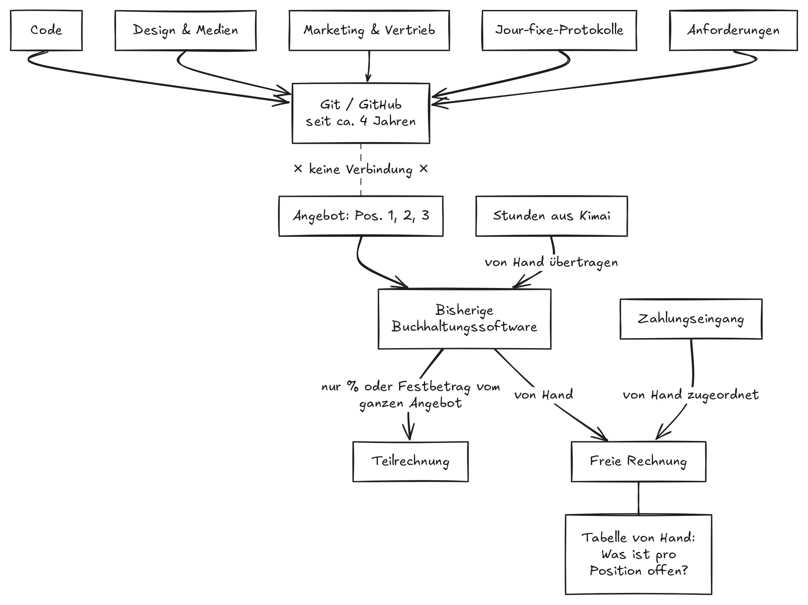
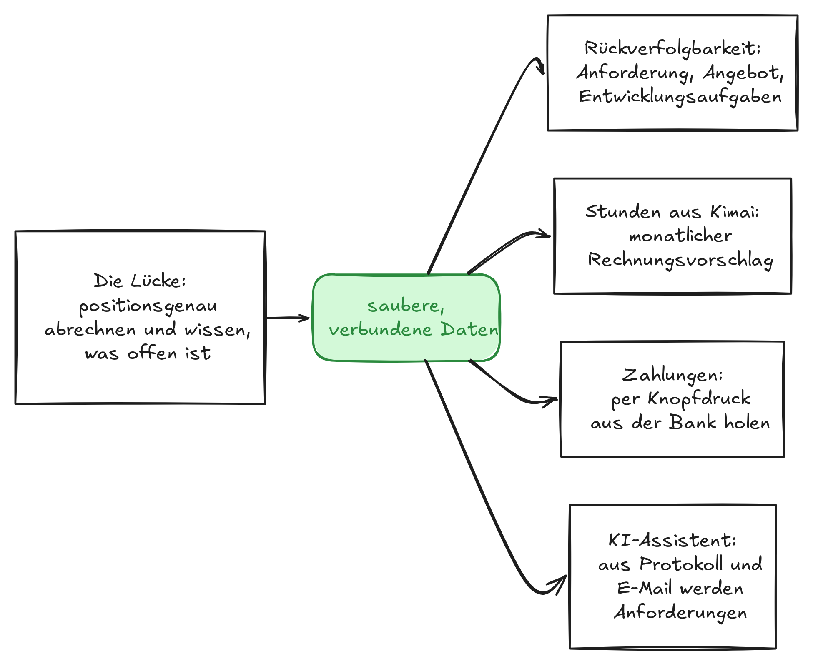
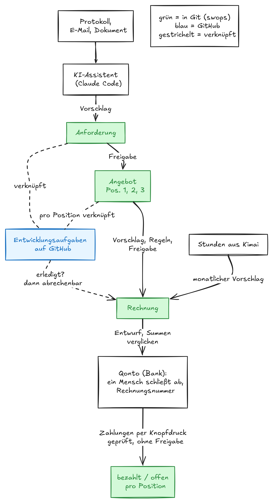

Seit vier Jahren gilt bei uns eine einfache Regel: Alles kommt nach Git. Der Code sowieso, aber auch Design,
Medien, Marketing- und Vertriebsunterlagen, jedes Protokoll aus unseren Kundenterminen und jede Anforderung.
Nur eins blieb draußen: das Geld. Hier erzählen wir, wie wir diese Lücke geschlossen haben, ohne ein ERP
einzuführen, und was das darüber verrät, wie man heute Software baut.

# Die Regel

Git ist ein System, das jede Änderung mit Autor, Zeitpunkt und Begründung festhält. Entwickler verwalten damit seit
Jahrzehnten ihren Quellcode. Wir verwalten damit seit etwa vier Jahren fast alles, was in unserer Firma entsteht,
und arbeiten auf GitHub gemeinsam daran. Eine Änderung läuft bei uns in der Regel über eine Freigabe: Sie wird als
Vorschlag eingereicht und erst danach übernommen. Wenn ein Kunde wissen will, was wir im März besprochen haben,
steht die Antwort an einem Ort, und man sieht, wer sie wann aufgeschrieben hat.

Mit einer Ausnahme. Angebote, Rechnungen und die Frage, was davon schon bezahlt ist, lagen woanders: in unserer
Buchhaltungssoftware und in einer Tabelle daneben.

# Warum das Geld draußen blieb

Der Grund war banal. Unsere bisherige Buchhaltungssoftware hatte keine Verbindung zu unseren Werkzeugen. Rechnungen
entstanden dort, wo die Software war, und blieben auch dort.

Solange man ein Angebot in einem Stück abrechnet, fällt das kaum auf. Bei uns ist das selten so. Ein typisches
Projektangebot hat mehrere Positionen, etwa ein Konzept, eine App und eine Schnittstelle. Abgerechnet wird, was
fertig ist: diesen Monat Position 1 und 3, in drei Monaten die Hälfte von Position 2, den Rest später.

Unsere bisherige Buchhaltungssoftware konnte eine Teilrechnung nur als Prozentsatz oder Festbetrag des gesamten
Angebots erstellen. „Position 1 und 3, bitte“ war damit nicht möglich. Also haben wir freie Rechnungen geschrieben und daneben eine
Tabelle geführt: Was ist pro Position schon berechnet, was ist noch offen? Gepflegt wurde sie von Hand, natürlich.

Von Hand lief auch der Rest. Die Stunden aus der Zeiterfassung haben wir jeden Monat in die Buchhaltungssoftware
übertragen und dort die Rechnung angelegt. Zahlungseingänge haben wir der richtigen Rechnung zugeordnet. Und während
Protokolle und Anforderungen längst sauber in Git lagen, führte von dort kein Weg zu Angebot und Rechnung.

Ein ERP-System hätte das gelöst. Für ein Unternehmen unserer Größe wäre das aber ein Projekt gewesen, das größer
ist als das Problem.

# Heute

> Heute geht bei uns keine Rechnung mehr an swops vorbei.

swops ist das System, das wir dafür gebaut haben. Der Rest dieses Artikels erklärt, was es tut, warum man ihm
trauen kann und warum wir dafür weder eine neue Buchhaltung noch ein ERP gebraucht haben.

# Standard kaufen, den eigenen Prozess bauen

Wir haben die Teile behalten, die Standard sind, und nur das gebaut, was es so nur bei uns gibt.

- **Qonto** ist unsere Bank und stellt unsere Rechnungen aus, mit der gesetzlichen Rechnungsnummer.
- **Kimai** bleibt unsere Zeiterfassung.
- **swops** ist die dünne Schicht dazwischen. Es weiß, was verkauft ist, was berechnet ist und was pro Position noch
  offen ist. Und es liegt in Git, neben den Protokollen und Anforderungen, aus denen jedes Angebot entstanden ist.

Eine naheliegende Frage: Kann die Bank das nicht selbst? Teilweise. Qonto kann Teilrechnungen pro Position
erstellen, behält aber nicht im Blick, was pro Position über mehrere Rechnungen hinweg offen bleibt. Und selbst wenn es das könnte: Diese Antwort gehört für uns dorthin, wo auch das
Angebot liegt und das Gespräch, aus dem es entstand.

Der Gewinn ist dieses Wissen, keine schönere Rechnung. Wir sehen jederzeit, was offen ist, und brauchen dafür keine
Tabelle mehr.

# Warum man dem System trauen kann

Hinter swops steckt ein einfacher Mechanismus. Er ist auch der Grund, warum wir es so schnell bauen konnten.

1. **Erst die Regeln, dann der Code.** Bevor wir eine Zeile programmiert haben, haben wir aufgeschrieben, was für eine
   Rechnung gelten muss. Über alle Rechnungen hinweg wird nie mehr berechnet als der vereinbarte Betrag einer
   Position. Kein Wartungszeitraum und keine erfasste Stunde wird zweimal berechnet. Und jede Rechnung nennt ihren
   Leistungszeitraum, so wie es das Umsatzsteuergesetz verlangt.
2. **Jede Rechnung beginnt als Vorschlag.** Das System prüft ihn gegen diese Regeln, und ein Mensch gibt ihn frei.
   In der Oberfläche lässt sich eine Rechnung, die eine Regel verletzt, gar nicht erst speichern.
3. **Die Bank wird nachgerechnet.** Den Rechnungsentwurf in der Bank vergleicht swops mit seinen eigenen Summen.
   Stimmen sie nicht überein, wird der Entwurf verworfen.
4. **Nichts wird von selbst endgültig.** Die gesetzliche Rechnungsnummer vergibt die Bank, und zwar erst, wenn ein
   Mensch die Rechnung dort abschließt.

# Wo KI geholfen hat, und wo nicht

swops haben zwei Entwickler in vier Wochen gebaut, nebenher. Niemand hat Vollzeit oder auch nur Teilzeit daran
gearbeitet. Programmiert haben wir mit Claude Code, einem KI-Assistenten, der nach unseren Vorgaben Code schreibt.

Die Arbeitsweise war immer gleich: Jede Fähigkeit begann als schriftliche Beschreibung und als Plan. Die KI hat den
Plan umgesetzt, wir haben das Ergebnis geprüft.

Was die KI nicht konnte: unser Geschäft kennen. Die erste Fassung unserer Regeln und Datenstruktur war sorgfältig
geplant. Am zweiten Tag haben wir echte alte Angebote und Rechnungen eingepflegt, und danach mussten wir sie an fünf
Stellen ändern. Eine alte Rechnung berechnete zum Beispiel 24 Monate Wartung in einer einzigen Zeile. Die erste
Fassung hätte daraus 400 Euro gemacht, auf einer Rechnung über 9.600 Euro. Gefunden hat das weder die KI noch eine
Regel, sondern ein Mensch, der den echten Beleg abgetippt hat.

Die schwierige Arbeit waren Entscheidungen, nicht Code. Wie wird auf den Cent gerundet, so wie es der Standard für
Rechnungen verlangt? Was muss laut Gesetz auf einer Rechnung stehen? Wer vergibt die Rechnungsnummer, wir oder die
Bank? (Die Bank.) KI ist schnell, wo die Regeln auf Papier stehen. Sie aufzuschreiben, bleibt Ihre Arbeit.

# Wie es wuchs

Angefangen hat swops mit der einen Lücke. Als die Daten einmal sauber verbunden waren, wurde jeder weitere Schritt
klein.

- **Woher kommt eine Anforderung?** Protokolle und Anforderungen lagen längst in Git, nur führte von dort kein Weg
  zu Angebot und Rechnung. Heute weiß jede Anforderung, aus welchem Protokoll oder Dokument sie stammt. Angebote
  entstehen aus Anforderungen, und jede Position ist mit den Entwicklungsaufgaben auf GitHub verknüpft, die sie
  umsetzen. Ein Blick in diese Aufgaben zeigt, ob eine Position fertig ist, und damit, was wir wann abrechnen
  können.
- **Stunden.** Früher haben wir die Stunden jeden Monat von Hand übertragen. Heute bestätigt bei Kunden, die nach
  Stunden abgerechnet werden, ein Mensch zum Monatsanfang, dass alle Stunden in Kimai erfasst sind. swops bereitet
  daraus einen Rechnungsvorschlag vor, den ein Mensch freigibt.
- **Zahlungen.** Früher haben wir Zahlungseingänge von Hand zugeordnet. Heute ordnet die Bank sie ihrer Rechnung zu,
  und swops übernimmt das per Knopfdruck, dorthin, wo steht, was verkauft und was noch offen ist.
- **Anforderungen aus Gesprächen.** Anforderungen kommen als Protokoll, als E-Mail, als Dokument, und jemand
  musste sie einzeln herausschreiben. Heute schlägt ein KI-Assistent in swops aus einem Protokoll oder einer
  E-Mail die Anforderungen vor, jeweils mit Verweis auf die Quelle. Ein Mensch übernimmt sie.

Damit auch Kolleginnen und Kollegen ohne Kommandozeile damit arbeiten können, gibt es eine Oberfläche und eine
Desktop-App.

# Das Zielbild

Vom Kundengespräch bis zur Zahlung ist jetzt alles verbunden, und jede Stelle weiß, woher sie kommt. Angebot,
Anforderungen und Entwicklungsaufgaben hängen zusammen. Ob eine Position fertig ist, zeigen die verknüpften Aufgaben
auf GitHub, und damit wissen wir, was wann abgerechnet werden kann. Den letzten Schritt haben wir bewusst nicht
automatisiert: Endgültig wird eine Rechnung erst, wenn ein Mensch sie in der Bank abschließt.

# Was das für Sie heißt

Welche Tabelle führen Sie neben Ihrer Standardsoftware? Diese Tabelle ist Ihre Lücke.

Lange hieß die Wahl: mit der Lücke leben oder ein ERP einführen. Heute gibt es einen dritten Weg. Man behält die
Standardwerkzeuge und baut eine dünne Schicht, die genau den eigenen Prozess abbildet und diese Werkzeuge verbindet.
Bei uns lief die erste Rechnung acht Tage nach der ersten Zeile Code über swops. Nach vier Wochen stand das Ganze,
gebaut nebenher von zwei erfahrenen Entwicklern.

Genau diese Erfahrung bringen wir mit, wenn Sie Ihre Lücke schließen wollen. Schreiben Sie uns über
[unsere Website](https://swcode.io/#kontakt) oder direkt unter dem LinkedIn-Beitrag zu diesem Artikel. Wir sind
gespannt, welche Tabelle bei Ihnen daneben liegt.
